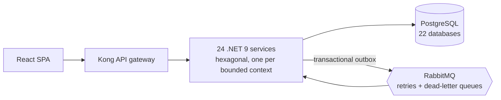

# Bryan Ibarra

Full-stack developer working in .NET and React. I build business software where a wrong number has a
real cost — accounting, tax compliance, payroll, inventory — and I measure it before I call it done.

## DevicSoft ERP

My main project: a multi-company ERP for businesses in Ecuador, built as microservices. The source is
private because it is a commercial product, so here is what it does and how it is built.

**What it covers**

- Accounting with a per-company chart of accounts, cost centers, closing periods and the five financial
  statements — postings resolved by rules, with no hard-coded accounts.
- Ecuadorian tax compliance (SRI): electronic invoicing, withholdings, VAT settlement and the ATS, RDEP,
  F101 and F103 filings, with the ATS XML validated against the official schema.
- Purchasing, sales, point of sale, inventory with lots and serial numbers, production planning,
  logistics, fixed assets and treasury.
- Payroll with a formula engine and income-tax calculation, plus an employee portal for payslips,
  vacations and time & attendance.
- Approval workflows, a self-service report builder, real-time notifications and a full audit trail.

**How it is built**

- Every service follows a strict hexagonal architecture; modules talk over REST for queries and over
  RabbitMQ for anything that posts to the ledger, so one module being down never blocks another.
- Tenant isolation is enforced in the data layer and tested end to end, including the internal
  service-to-service endpoints.
- Money is stored as integer minor units from the database to the UI; floating point never touches the
  books.
- Around 450 end-to-end and static guard scripts protect the rules that have broken before.

## Problems I've solved

- **Lost orders under load.** Eight simultaneous purchase orders produced two documents and six errors
  because numbering read and wrote in two steps. Making the sequence atomic took it to eight out of
  eight — measured before and after.
- **Edits that silently overwrote each other.** Two people saving the same record both got a success
  response and one change disappeared. Optimistic concurrency with versioned `If-Match` requests turned
  that into a clear conflict the user can resolve.
- **Capacity measured, not guessed.** Load testing set the limit at 250 requests per second with zero
  errors; past that the system queues instead of failing, because connection pools and message queues
  are bounded on purpose.

## En español

Desarrollador full-stack en .NET y React. Construyo software de gestión donde un número equivocado
cuesta dinero —contabilidad, impuestos, nómina, inventario— y lo mido antes de darlo por terminado.

Mi proyecto principal es **DevicSoft ERP**, un ERP multiempresa para Ecuador hecho con microservicios:
contabilidad, facturación electrónica y anexos del SRI, compras, ventas, punto de venta, inventario,
producción, tesorería, activos fijos y nómina con portal del empleado. El código es privado porque es
un producto comercial.

---

Open to conversations about .NET, software architecture and ERP systems — reach me through GitHub.
